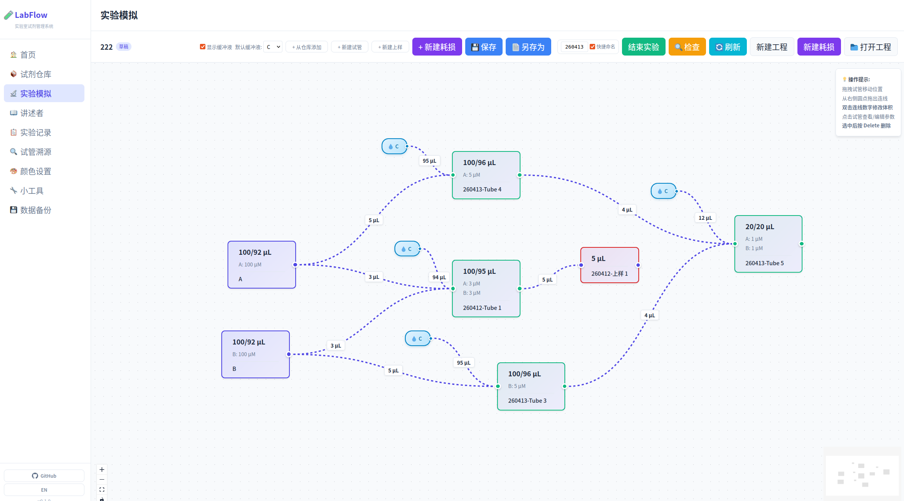
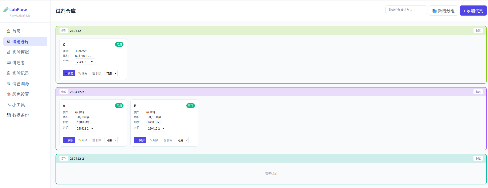
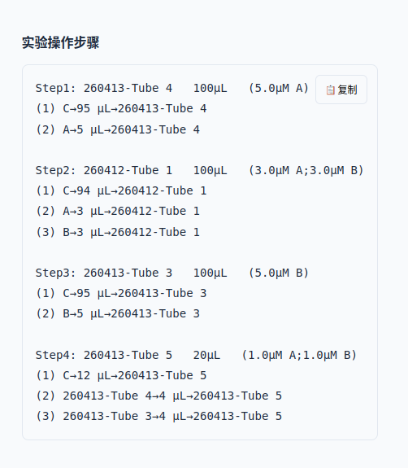
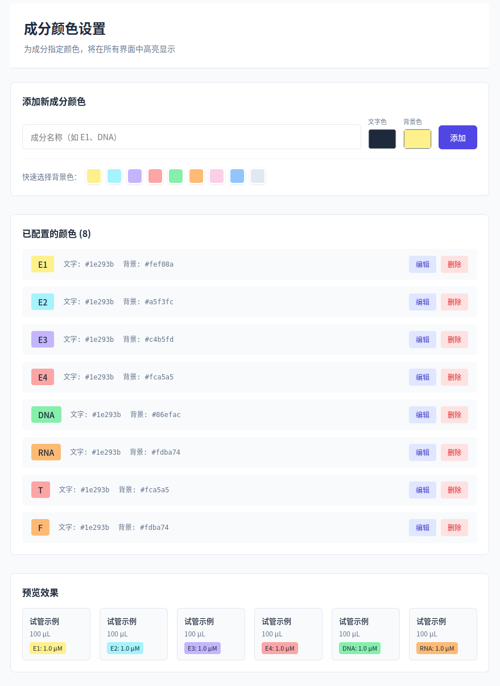
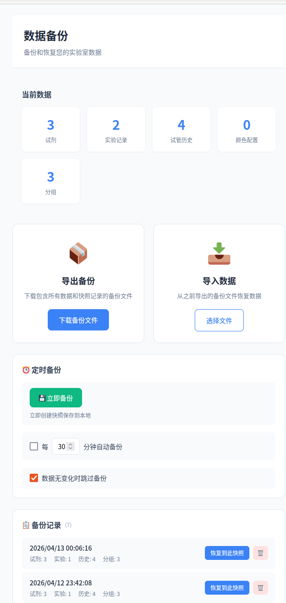

<div align="center">

### 🌐 [English Version / 英文文档](README_EN.md)

</div>

---

# LabFlow

> 实验室试剂管理与实验流程模拟工具 — 让实验设计更直观、更高效

## 🆕 v0.2.3 更新内容

- 🐛 **修复**：讲述者页面无法通过鼠标滚轮滚动的问题
- 🐛 **修复**：数据备份页面无法通过鼠标滚轮滚动的问题

---

## 🆕 v0.2.1 更新内容

- 🐛 **修复**：仓库试管重命名后溯源界面名称同步更新
- 🐛 **修复**：仓库界面滚动条问题，防止内容过多时元素挤压变窄
- 🐛 **修复**：Layout 布局滚动问题，强制滚动只在试管列表内发生

---

## 🆕 v0.2.0 更新内容

- 🏠 **全新首页**：时钟、搜索、每日名言，启动即有归属感
- 🧰 **小工具**：核酸链计算器（序列长度 ↔ 分子量快速换算）
- 📦 **试管分组**：按批次对试剂分组管理，支持折叠、搜索定位
- 🎙️ **讲述者**：将流程图自动转化为可复制的 SOP 文本步骤
- 🎨 **成分颜色配置**：自定义各成分的文字色与背景色，试管标签一目了然
- 💾 **数据备份**：定时自动备份 + 快照恢复 + 导出/导入 JSON
- 🔤 **深色/浅色主题** + **字号调节**（12–20 px）
- 🔧 **刷新按钮**：重新读取原料数据并重新计算中间产物
- 🐛 **修复**：实验回退/完成状态持久化问题

---



## 🚀 快速开始

### Windows 用户（推荐一键安装）

1. **下载安装脚本**
   👉 [点击下载 LabFlow-Installer.bat](https://raw.githubusercontent.com/Luminave/LabFlow/main/LabFlow-Installer.bat)

2. **运行安装脚本**
   - 右键点击下载的 `LabFlow-Installer.bat`
   - 选择 **"以管理员身份运行"**
   - 按照提示完成安装（自动安装 Git 和 Node.js）

3. **启动 LabFlow**
   - 桌面会出现 `Start-LabFlow` 快捷方式，双击即可启动
   - 浏览器自动打开 http://localhost:5173/

### Linux / macOS 用户

```bash
git clone https://github.com/Luminave/LabFlow.git
cd LabFlow
npm install
npm run dev
# 访问 http://localhost:5173/
```

---

## 功能特性

### 📦 试剂仓库管理



- **CRUD 操作**：添加、编辑、删除试剂，追踪名称、体积、浓度、存储位置
- **试管分组**：按批次自动命名（如 `260412`），支持 12 种预设颜色随机分配
  - 分组可折叠 / 展开，折叠状态持久化
  - 顶部搜索框支持按试剂名或分组名搜索，点击结果自动定位并闪烁高亮
  - 未分组的试剂显示在分组方框之外
- **分组管理**：点击「修改」弹出编辑窗口，可改名、换色（8 预设 + 自定义色盘）、填写备注
- **状态管理**：可用 / 不足 / 已弃，试剂卡片直接切换分组

### 🔬 实验流程模拟

- **可视化流程图**：基于 React Flow，拖拽添加试管节点，连线表示移液操作
- **从仓库添加试剂**：点击节点即可将仓库中的试剂加入实验
- **新建试管 / 上样**：创建中间产物节点，拖出连线到目标试管
- **移液体积编辑**：点击连线上的数字直接修改移液量
- **浓度自动计算**：每次移液后自动更新目标试管的浓度与总体积
- **检查功能**：一键检查所有试管的浓度与体积是否合理，结果展示在右侧面板
- **耗损 / 作为原料**：支持标记试剂耗损或指定为原料
- **实验时间**：记录实验各步骤耗时
- **刷新按钮**：重新读取原料数据并重新计算所有中间产物

### 🎙️ 讲述者（SOP 生成器）



- **自动生成 SOP**：将流程图自动转化为线性文本步骤
- **配置序号**：为试管指定 `configOrder`，讲述者按序号排列操作步骤
- **一键复制**：每步右侧「复制」按钮，方便粘贴到实验记录或论文
- **体积排序**：步骤按移液体积从大到小排列，优先显示主要成分

### 🎨 成分颜色配置



- **自定义配色**：为每种成分（如 DNA、RNA、蛋白）设置文字色和背景色
- **快速预设**：9 色快速色板，一键应用
- **实时预览**：底部试管模型卡片展示配色在实际 UI 中的效果
- **HEX 色值**：精确到 #RRGGBB，满足论文级配图需求

### 💾 数据备份



- **数据概览**：一目了然查看试剂数、实验记录、试管历史、分组数量等统计
- **定时自动备份**：默认每 30 分钟自动备份，支持自定义间隔
- **无变化跳过**：数据无变化时自动跳过，节省存储空间
- **快照恢复**：备份历史列表，点击「恢复到此快照」一键回档
- **导出 / 导出**：导出为 JSON 文件，支持导入恢复

### 📋 实验记录

- **保存实验历史**：每次结束实验自动保存
- **查看实验详情**：回顾实验中每个试管的最终状态
- **回退实验**：支持回退到实验前的仓库状态

### 🔍 试管溯源

- 每个试管分配唯一编号（如 `260413-Tube 4`）
- 追踪试管来源和去向
- 记录在哪些实验中被使用

### ⚙️ 其他

- 🌗 **深色 / 浅色主题切换**
- 🔤 **字号调节**：12 – 20 px，适配不同屏幕与视力需求
- 🌐 **中英文切换**

---

## 技术栈

| 技术 | 用途 |
|------|------|
| **React 18** + **TypeScript** | 前端框架 |
| **React Flow** (`@xyflow/react`) | 流程图可视化 |
| **Zustand** | 状态管理 |
| **sql.js** (SQLite) | 本地数据存储 |
| **Vite** | 构建与开发服务器 |
| **react-router-dom** | 页面路由 |
| **date-fns** | 日期处理 |

---

## 📁 项目结构

```
LabFlow/
├── src/
│   ├── renderer/              # 渲染进程（React 应用）
│   │   ├── components/
│   │   │   ├── Layout.tsx     # 布局（导航栏 + 版本号）
│   │   │   └── TransferEdge.tsx  # 自定义移液连线
│   │   ├── pages/
│   │   │   ├── HomePage.tsx       # 首页
│   │   │   ├── WarehousePage.tsx  # 试剂仓库
│   │   │   ├── ExperimentPage.tsx # 实验模拟
│   │   │   ├── RecordPage.tsx     # 实验记录
│   │   │   ├── NarratorPage.tsx   # 讲述者
│   │   │   ├── BackupPage.tsx     # 数据备份
│   │   │   └── ToolsPage.tsx      # 小工具
│   │   ├── stores/            # Zustand 状态管理
│   │   ├── i18n/              # 国际化
│   │   └── styles/            # CSS Module 样式
│   └── shared/
│       ├── types/             # TypeScript 类型定义
│       └── utils/             # 工具函数（数据库、备份等）
├── vite.config.browser.ts     # 浏览器模式 Vite 配置
├── LabFlow-Installer.bat      # Windows 一键安装脚本
├── Start-LabFlow.bat          # Windows 启动脚本
└── screenshots/               # README 截图
```

---

## 🤖 怎么搭配 Agent 用

LabFlow 的真相是纯文本（`仓库.yml` + `工程/<名>.yml`），Agent 可以直接读写工程文件；配套 skill 把「写哪个文件、怎么校验、什么时候提醒你重载」固定下来，不用每次重新讲一遍。

**装 skill**

1. 把仓库里的 `skills/labflow-project/SKILL.md` 复制到 `C:\Users\27133\.dsh\skills\labflow-project\`（目录名必须是 `labflow-project`，文件名必须是 `SKILL.md`）；
2. 重启 DSH —— 启动时扫描该目录，skill 列表里出现 `labflow-project` 就装好了。

**给 Agent 的三条硬约束**

| # | 约束 | 为什么 |
|---|---|---|
| 1 | 写文件 → `validate` 退出码必须为 0 → 回复里提醒用户「点顶栏『重新载入』」 | LabFlow 不监听文件，只在「打开工程」时读一次盘；不重载，界面上还是旧内容 |
| 2 | 不许替用户点界面里的「保存」 | 保存写的是界面内存，内存可能还是旧版，一点就把 Agent 刚写的文件盖掉 |
| 3 | 不许自己填一个"看起来对"的浓度来骗过校验 | 校验是最后一道闸；绕过去之后错的是实验，不是文件 |

**可以直接复制的命令**

```bash
node dist-cli/labflow.mjs validate 261123            # 退出码 0 通过 / 1 有问题 / 2 用法错
node dist-cli/labflow.mjs calc 261123                # 每管最终成分与体积
node dist-cli/labflow.mjs export 261123 --out "D:\学习\labflow\导出\261123"
```

> 没构建过就先 `npm run build:cli`。这三个命令默认**只算不写**，不动任何工程文件。

**重载的两种情形**：顶栏挂出「工程文件已被外部修改」时点「重新载入」；保存时弹出「重新载入 / 覆盖」，选**重新载入**（= 保留 Agent 写的磁盘版本），选「覆盖」就把界面旧内容写回去了。

---

## 📝 怎么搭配 Obsidian 用

把导出目录放进 Obsidian 仓库（vault）里，SOP 和流程图就能被双链索引、直接嵌进笔记。

**导出开关推荐**（在「讲述者 → 3. 导出工程」里设）

| 开关 | 推荐 | 理由 |
|---|---|---|
| SOP `.md` | **开** | 笔记里能直接链、能全文搜索 |
| 流程图 `.png` | **开** | 配液顺序一眼看懂，比读文字快 |
| 白板 `.canvas` | **关** | 坐标归应用管，在 Obsidian 里改完一重存就丢 |
| 数据 `.yml` 副本 | **关** | 只当备份、永不回读，留着只会和正本混淆 |

**目录放哪**：在 vault 里建一个固定目录，例如 `D:\学习\labflow\导出\<工程名>`，一个工程一个子目录。

**笔记里怎么引**

```md
![[2026-11-23-261123.png]]     ← 嵌流程图
[[2026-11-23-261123]]          ← 链到 SOP，点开就是完整步骤
```

SOP 头部还带一条 `labflow://open?project=<工程名>` 链接，在 Obsidian 里点它会唤起 LabFlow 并载入该工程（应用没开也能冷启动打开）。

**为什么别在 Obsidian 里改 canvas**：`.canvas` 只是当前画布的一次快照，布局正本是 yml 里的 `x` / `boardX`。在 Obsidian 里拖完不会回写，下次应用导出就照原样覆盖；要改布局就改 yml，或者在应用里拖。

> 已知缺陷：画布很密（几十支管）时导出的 PNG 会被裁边，导出前先把视图缩到能看全。

---

## 开发

### 浏览器模式（推荐）

```bash
npm install
npm run dev
# 访问 http://localhost:5173/
```

### Electron 桌面应用模式（实验性）

```bash
npm install
npm run electron:dev
```

> ⚠️ Electron 模式可能需要额外配置，建议优先使用浏览器模式。

---

## 🔧 故障排除

### Windows

| 问题 | 解决方案 |
|------|----------|
| 安装脚本需要管理员权限 | 右键 → 以管理员身份运行 |
| Git / Node.js 下载慢 | 耐心等待，或手动安装后重试 |
| 浏览器未自动打开 | 手动访问 http://localhost:5173/ |
| `npm 不是内部命令` | 安装 Node.js 后重启终端 |

### Linux

```bash
# 端口 5173 被占用
lsof -i :5173
kill -9 <PID>
```

---

## License

MIT
