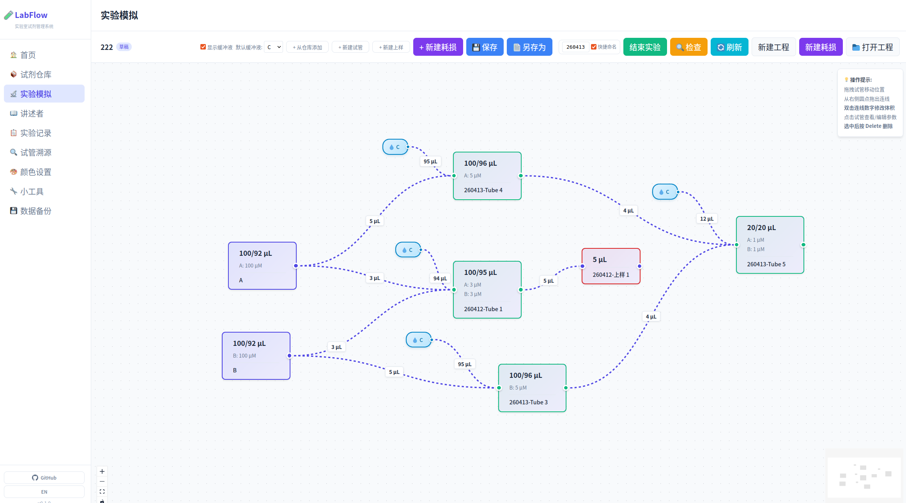
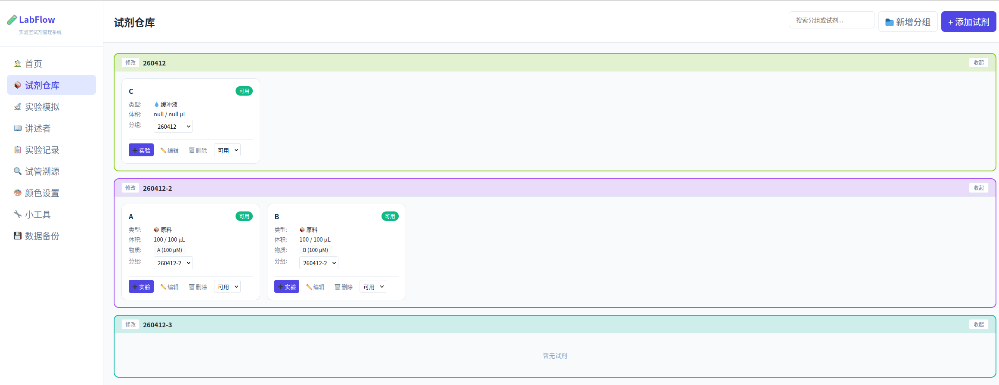
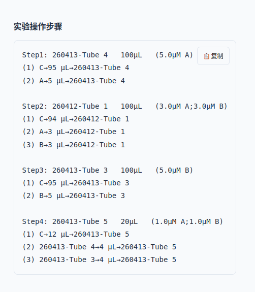
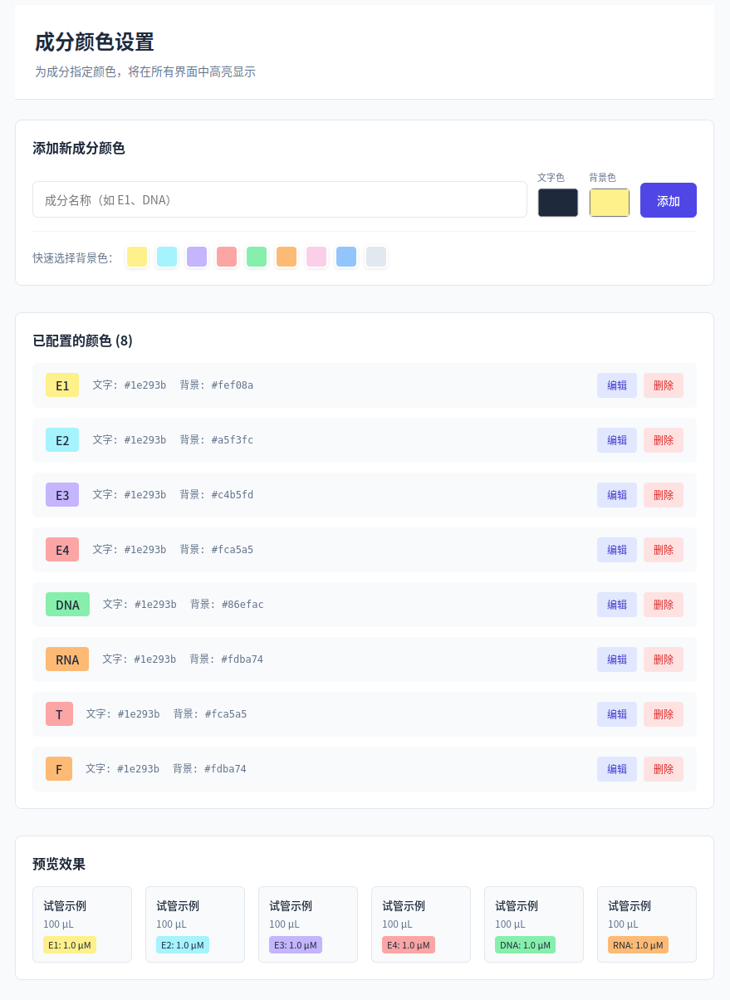
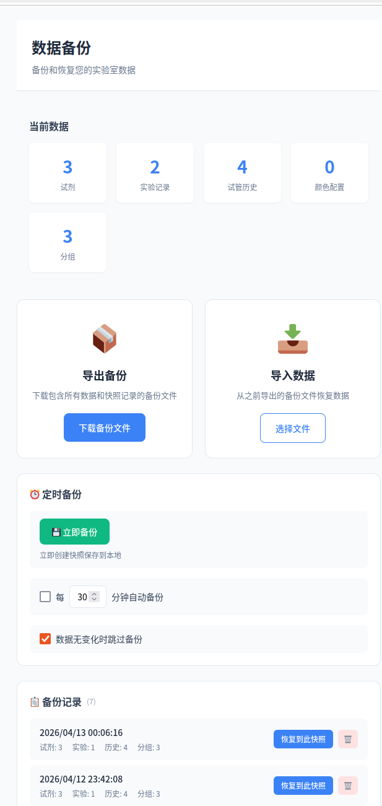

# LabFlow

> A visual laboratory reagent management and experiment workflow simulator — making experiment design more intuitive and efficient

## ⬇️ Download

👉 **[Get the latest release](https://github.com/Luminave/LabFlow/releases/latest)**

| Edition | File | Notes |
|---|---|---|
| **Installer (recommended)** | `LabFlow Setup 0.2.18.exe` | Adds Start-menu / desktop entries and registers the `labflow://` protocol, so notes and web pages can open a project directly |
| **Portable** | `LabFlow 0.2.18.exe` | No installation, no registry writes — double-click to run; copy it to another machine and it still works |

> On first launch Windows may warn about an unknown publisher — click **More info → Run anyway**.
> GitHub replaces spaces in asset names with dots: the installer downloads as `LabFlow.Setup.0.2.18.exe` (same file).

---

## 🆕 What's New in v0.2.18

- 🔒 **`concentration_mismatch` when nominal and reachable concentration differ by more than 5%**: a recipe that claims a nominal concentration but cannot be reached through the transfer graph now fails validation instead of silently producing an impossible dilution plan
- 🖼️ **Auto `fitView` before exporting screenshots**: `minZoom 0.05` plus the union of all node bounds, so dense boards are no longer cropped
- 📄 **Project source of truth moved to plain files**: `仓库.yml` + `工程/<name>.yml`; the UI reads from disk when a project is opened, and agents can read/write the files directly
- 🔐 **Agent lock + `labflow` CLI**: the lock blocks every write entry point and cannot be stolen by another owner; `validate / calc / export` compute only and never write by default
- 🔗 **`labflow://` deep links**: open a project from Obsidian, a web page or an agent, including cold start
- 🧩 **`labflow-project` skill and agent operating rules**: new skill plus `docs/数据正本与Agent协作.md`, fixing the "write → validate → tell the user to reload" loop
- 🪟 **Screenshot folder moved**: `screenshots/` → `docs/screenshots/`
- 🐛 Also: tighter settlement / revert bounds, hash-based conflict detection, deleting a project now archives it, file watcher covers the `工程/` subdirectory, file-only projects now show up in the project list

> v0.2.4–v0.2.17: internal iterations (input freeze fixes, database transactions and backups, app icons and packaging, drag-connect bugs) — see the commit history.

---

## 🆕 What's New in v0.2.3

- 🐛 **Fix**: Narrator page could not be scrolled with mouse wheel
- 🐛 **Fix**: Data Backup page could not be scrolled with mouse wheel

---

## 🆕 What's New in v0.2.0

- 🏠 **Brand New Home Page**: Clock, search, daily quotes — a welcoming start every time
- 🧰 **Utility Tools**: Nucleic acid chain calculator (sequence length ↔ molecular weight conversion)
- 📦 **Tube Grouping**: Group reagents by batch, with collapse and search-to-locate support
- 🎙️ **Narrator**: Automatically converts flowcharts into copyable SOP text steps
- 🎨 **Component Color Config**: Custom text and background colors for each component on tube labels
- 💾 **Data Backup**: Scheduled auto-backup + snapshot restore + JSON export/import
- 🌗 **Dark / Light Theme** + **Font Size Adjustment** (12–20 px)
- 🔧 **Refresh Button**: Reload raw material data and recalculate all intermediate products
- 🐛 **Fixes**: Experiment revert / completion state persistence

---



## 🚀 Quick Start

### Windows installer (recommended)

1. Download `LabFlow Setup 0.2.18.exe` from [Releases](https://github.com/Luminave/LabFlow/releases/latest)
2. Run it (unknown publisher → More info → Run anyway)
3. Launch from the Start menu or desktop shortcut; the `labflow://` protocol is registered

### Windows portable

1. Download `LabFlow 0.2.18.exe` from the same Releases page
2. Double-click to run — no install, no registry (no `labflow://` deep links, everything else identical)

### From source (Windows / Linux / macOS)

```bash
git clone https://github.com/Luminave/LabFlow.git
cd LabFlow
npm install
npm run electron:dev   # desktop mode (Electron, the main form)
npm run dev            # browser mode: http://localhost:5173/
```

> `LabFlow-Installer.bat` / `Start-LabFlow.bat` are legacy scripts from the browser-only era: they install Git + Node and start `npm run dev`. They are **not** an installation method — use the installers above.

---

## Features

### 📦 Reagent Warehouse



- **CRUD Operations**: Add, edit, delete reagents. Track name, volume, concentration, storage location
- **Tube Grouping**: Auto-named by batch (e.g. `260412`), 12 preset colors randomly assigned
  - Groups can be collapsed / expanded with persistent state
  - Search bar supports searching by reagent or group name, with auto-locate and highlight flash
  - Ungrouped reagents displayed outside group boxes
- **Group Management**: Edit name, color (8 presets + custom palette), and notes
- **Status Management**: Available / Low / Deprecated — switch directly on reagent cards

### 🔬 Experiment Simulation

- **Visual Flowchart**: Drag-and-drop tube nodes, connect with liquid transfer lines
- **Add from Warehouse**: Click to add warehouse reagents to your experiment
- **Create Tubes / Load Samples**: Create intermediate product nodes
- **Volume Editing**: Click the number on a connection line to modify transfer volume
- **Auto Concentration Calculation**: Target tube concentration and total volume updated in real-time
- **Check Function**: One-click validation of all tube concentrations and volumes, results in the right panel
- **Consumption / Raw Material**: Mark reagents as consumed or designate as raw materials
- **Experiment Timer**: Track time spent on each step
- **Refresh Button**: Reload raw material data and recalculate all intermediate products

### 🎙️ Narrator (SOP Generator)



- **Auto-generate SOP**: Converts flowcharts into linear text steps
- **Config Order**: Assign `configOrder` to tubes, narrator follows the sequence
- **One-click Copy**: Copy button on each step for easy pasting into lab notebooks or papers
- **Sorted by Volume**: Steps sorted by transfer volume (largest first), major components shown first

### 🎨 Component Color Configuration



- **Custom Colors**: Set text and background colors for each component (e.g. DNA, RNA, protein)
- **Quick Presets**: 9-color palette for one-click application
- **Live Preview**: Tube model cards at the bottom show how colors render in the actual UI
- **HEX Values**: Precise #RRGGBB for publication-quality figures

### 💾 Data Backup



- **Data Overview**: At-a-glance statistics — reagent count, experiment records, tube history, group count
- **Scheduled Auto-backup**: Default every 30 minutes, customizable interval
- **Skip When Unchanged**: Automatically skips backup if no data changes detected
- **Snapshot Restore**: Browse backup history, click "Restore to this snapshot" to roll back
- **Export / Import**: Export as JSON file, import to restore

### 📋 Experiment Records

- **Auto-save History**: Each experiment is saved automatically when completed
- **View Details**: Review the final state of every tube in an experiment
- **Revert Experiment**: Roll back warehouse state to before the experiment

### 🔍 Tube Traceability

- Unique ID assigned to each tube (e.g. `260413-Tube 4`)
- Track tube origin and destination
- Record which experiments used each tube

### ⚙️ More

- 🌗 **Dark / Light theme toggle**
- 🔤 **Font size adjustment**: 12 – 20 px, adapts to different screens and visual needs
- 🌐 **Chinese / English language switch**

---

## Tech Stack

| Technology | Purpose |
|------------|---------|
| **Electron** + **electron-builder** | Desktop shell and packaging (installer / portable) |
| **React 18** + **TypeScript** | Frontend framework |
| **React Flow** (`@xyflow/react`) | Flowchart visualization |
| **Zustand** | State management |
| **js-yaml** | Reading/writing the plain-file project source (`仓库.yml` / `工程/<name>.yml`) |
| **sql.js** (SQLite) | Index, history and backups |
| **Vite** | Build tool & dev server |
| **react-router-dom** | Routing |
| **date-fns** | Date utilities |
| **Vitest** | Unit tests (`tests/`) |

---

## Project Structure

```
LabFlow/
├── electron/                  # Main process (window, deep links, data root, file watcher)
├── src/
│   ├── core/                  # Project source-of-truth files, validation (incl. concentration_mismatch), settlement
│   ├── cli/                   # CLI `labflow`: validate / calc / export
│   ├── renderer/              # Renderer process (React app)
│   │   ├── components/
│   │   │   ├── Layout.tsx     # Layout (nav bar + version)
│   │   │   └── TransferEdge.tsx  # Custom transfer edge
│   │   ├── pages/
│   │   │   ├── HomePage.tsx       # Home
│   │   │   ├── WarehousePage.tsx  # Reagent warehouse
│   │   │   ├── ExperimentPage.tsx # Experiment simulation
│   │   │   ├── RecordPage.tsx     # Experiment records
│   │   │   ├── NarratorPage.tsx   # Narrator
│   │   │   ├── BackupPage.tsx     # Data backup
│   │   │   └── ToolsPage.tsx      # Utility tools
│   │   ├── stores/            # Zustand state management
│   │   ├── i18n/              # Internationalization
│   │   └── styles/            # CSS Module styles
│   └── shared/
│       ├── types/             # TypeScript type definitions
│       └── utils/             # Utilities (database, backup, etc.)
├── docs/                      # Docs and screenshots/ (README images)
├── skills/labflow-project/    # Skill for agent-assisted project editing
├── tests/                     # Vitest unit tests
├── vite.config.ts             # Electron desktop build config
├── vite.config.browser.ts     # Browser-only Vite config
├── LabFlow-Installer.bat      # Legacy script (installs Git+Node, runs browser dev server)
├── Start-LabFlow.bat          # Legacy launcher (same caveat)
└── package.json
```

---

## 🤖 Using LabFlow with an Agent

LabFlow's source of truth is plain text (`仓库.yml` + `工程/<name>.yml`), so an agent can read and write project files directly. The companion skill fixes down *which file to write, how to validate, when to remind you to reload*, so you don't have to explain it every session.

### After installing LabFlow: how to get your agent to use the skill

The installer only ships the app — **it does not bundle `skills/`**. A freshly installed machine has no `SKILL.md`, so grab a copy first.

**1. Get `SKILL.md`** (pick one)

- Download from the repo: [`skills/labflow-project/SKILL.md`](https://raw.githubusercontent.com/Luminave/LabFlow/master/skills/labflow-project/SKILL.md) (open it and copy the whole text, or save the page);
- If you already cloned the repo, use `skills/labflow-project/SKILL.md` from your clone.

The file must be named `SKILL.md` and its folder must be named `labflow-project` — those two names are how the agent finds the skill; rename them and it will not be loaded.

**2. Put it in your agent's skill directory**

| Agent | Where to put it | Notes |
|---|---|---|
| DSH | `~/.dsh/skills/labflow-project/SKILL.md` (on Windows: `C:\Users\<your-user>\.dsh\skills\labflow-project\SKILL.md`) | Restart DSH afterwards — it scans this directory at startup |
| Claude Code | `~/.claude/skills/labflow-project/SKILL.md` | Same as above; restart the session for it to take effect |
| Others (Cursor / Copilot etc., which have no skill directory) | Paste the whole `SKILL.md` into the project's `AGENTS.md` or rules file | Works like a permanent system prompt |

**3. Check that it loaded**

- Start a new session and ask "which skills do you have?", or simply say "put this experiment into LabFlow";
- If it follows the procedure (write `工程/<name>.yml` → run validate → remind you to click "Reload"), it loaded;
- If it immediately tells you to click things in the UI by hand, it did not read the skill.

**4. One sentence you can copy**

> Use the labflow-project skill to put this experiment into LabFlow. Project name 261124: write the solution-prep flow into `工程/261124.yml` first, run validate until it exits 0, then tell me whether I need to reload.

**Three hard rules for the agent**

| # | Rule | Why |
|---|---|---|
| 1 | Write the file → `validate` must exit 0 → tell the user to click "Reload" in the top bar | LabFlow does not watch files; it reads from disk only when a project is opened, so the UI keeps showing stale content until you reload |
| 2 | Never click "Save" in the UI on the user's behalf | Save writes the in-memory state, which may be stale and would overwrite what the agent just wrote |
| 3 | Never invent a "plausible" concentration to get past validation | Validation is the last gate; bypassing it produces a wrong experiment, not just a wrong file |

**Commands you can copy**

```bash
node dist-cli/labflow.mjs validate 261123            # exit 0 pass / 1 problems / 2 usage error
node dist-cli/labflow.mjs calc 261123                # final composition and volume per tube
node dist-cli/labflow.mjs export 261123 --out "D:\学习\labflow\导出\261123"
```

> Build them first if you haven't: `npm run build:cli`. All three compute only — they never write to project files.

> **Honest note**: these three CLI commands require the source repo (`npm run build:cli` produces `dist-cli/labflow.mjs`). **The installer and portable builds currently ship without the CLI**: after installing, the agent can only read/write the `.yml` files directly and use the "Check" button in the app. If you only installed the packaged build, treat these commands as a reference for what the agent is supposed to do.

**Two reload cases**: when the top bar shows "project file modified externally", click "Reload"; when saving pops up "Reload / Overwrite", choose **Reload** (= keep the version the agent wrote to disk) — "Overwrite" writes the stale UI content back.

---

## Development

### Desktop mode (main form)

```bash
npm install
npm run electron:dev      # Vite + Electron with hot reload
npm run electron:build    # build installer + portable (output in release/)
```

### Browser mode (UI debugging)

```bash
npm install
npm run dev
# Visit http://localhost:5173/
```

> Browser mode has no `labflow://` deep links and cannot touch the local project folder — use it for UI work only.

### CLI and tests

```bash
npm run build:cli    # build dist-cli/labflow.mjs
npm run labflow -- validate 261123
npm test             # Vitest
```

---

## Troubleshooting

### Windows

| Issue | Solution |
|-------|----------|
| "Unknown publisher" / SmartScreen block | Click **More info → Run anyway** |
| `labflow://` links do nothing | Deep links are registered by the **installer** only; the portable build opens the app directly |
| Still seeing the old UI after updating | Quit the old process (including tray) and relaunch; local data is preserved |
| `npm not recognized` | Install Node.js, then restart terminal |
| Blank window in source mode | Make sure the Vite dev server from `npm run electron:dev` is listening on port 5173 |

### Linux

```bash
# Port 5173 is in use
lsof -i :5173
kill -9 <PID>
```

---

## License

MIT
